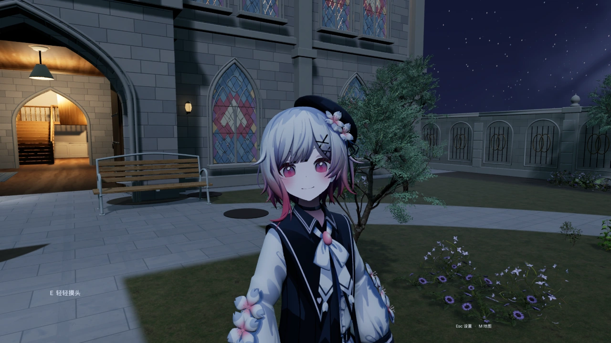
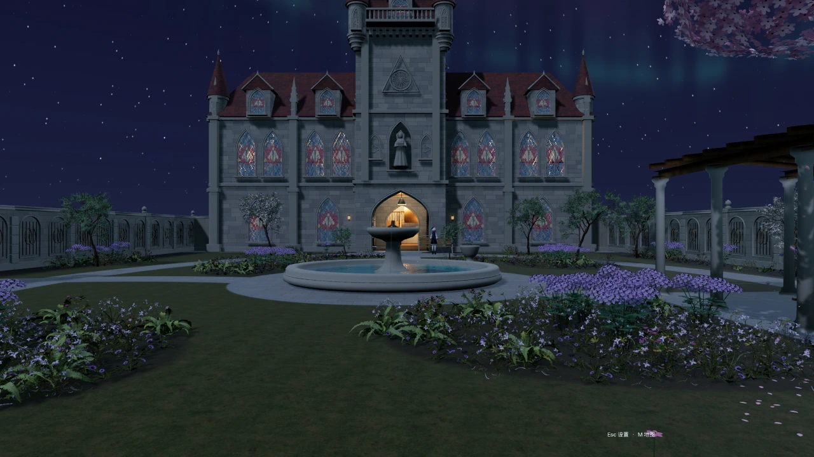
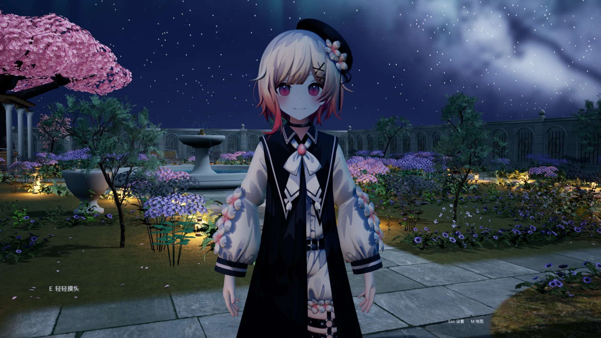
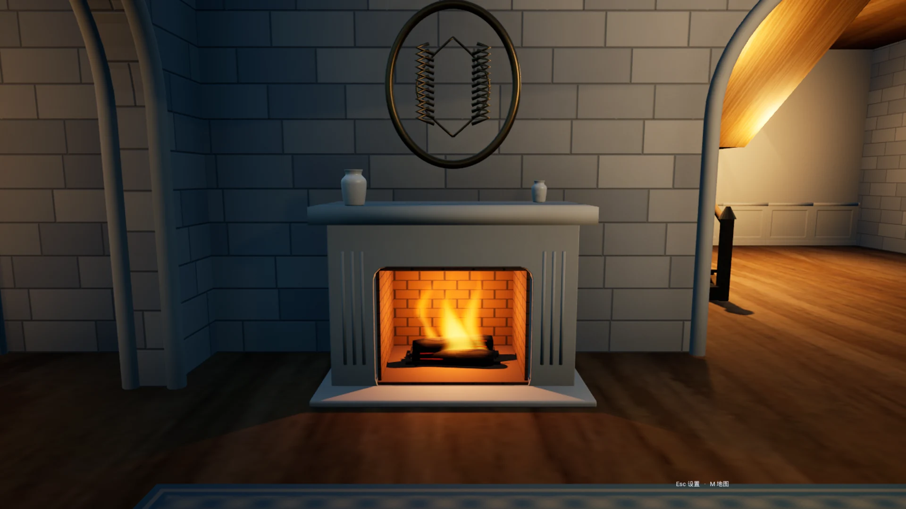
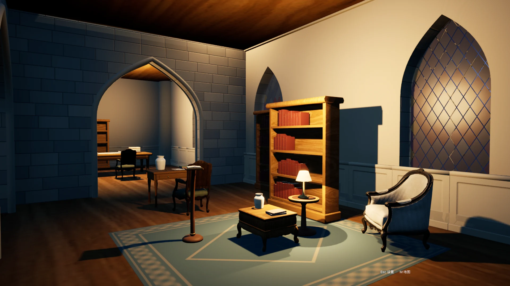

# 月夜の庭園 · エマ

[简体中文](README.md) · [繁體中文](README.zh-TW.md) · [English](README.en.md) · [日本語](README.ja.md) · [한국어](README.ko.md)

**月明かりに、少し時間を。**

青紫の夜空の下、花の小径を歩き、暖かな部屋へ戻り、桜の木のそばで桜羽エマと過ごす。戦闘やクエストに急かされず、風と水の音、ふとした反応を楽しむ庭園体験です。

**[Windows版を無料ダウンロード](https://github.com/IKMXKT-love/MoonlitCourtyard/releases/download/v0.49.3/MoonlitCourtyard-v0.49.3-Windows.zip)** · [更新内容](https://github.com/IKMXKT-love/MoonlitCourtyard/releases/tag/v0.49.3)

v0.49.3 · Windows 64ビット · 約670 MiB · 完全無料

ゲーム内UIは現在主に中国語です。画像は実際のゲーム画面です。

## 花影から、暖かな窓辺へ

花の木、水辺、邸宅を視線のつながる空間として構成。庭園、一階、二階を歩き、好きな眺めを探せます。

*アーチ窓と尖塔、暖かな窓明かりが庭園の向こうに。*

## エマと過ごす

対応する場所で散歩、花の鑑賞、暖炉で手を温める、ステンドグラスのそばでの滞在などを行います。反応は状況に応じて変化します。

*プレイヤーが座った状態でもEへの笑顔が見えます。エマは近くに立っています。*

> 近づいてエマの方を向き、案内を待ってください。移動中や別の行動中は一部の反応を控えます。エマの自律的な着座・起立は未公開です。

## 夜の庭園から戻れる部屋

<table>
<tr>
<td width="50%">

暖炉とお茶の席が、室内の休憩空間をつなぎます。

</td>
<td width="50%">

本棚や読書コーナーを探索できます。エマが自分で座って読む行動は未完成です。

</td>
</tr>
</table>

## 操作方法

### 移動と姿勢

| 入力 | 操作 |
|---|---|
| `W / A / S / D` | 移動 |
| `Mouse` | 見回す |
| `Shift` | 押している間加速 |
| `Space` | ジャンプ |
| `Ctrl` | しゃがむ / 立つ |
| `C` | うつ伏せ / 立つ |
| `X` | 仰向け / 立つ |

### エマと場面

| 入力 | 操作 |
|---|---|
| `E` | 距離と状態が適切なときにふれあう |
| `F` | 指定席で座る / 立つ |
| `G` | 花を摘む / 見せる / 置く |
| `R` | 近くの扉を開閉 |

### マップと設定

| 入力 | 操作 |
|---|---|
| `M` | 庭園・階層マップ |
| `Esc` | 設定 / 戻る |

初期キーです。変更できる項目はゲーム設定に従います。Fは指定席、Rは扉の近くで使用し、低い姿勢から立つには空間が必要です。

## はじめての訪問

1. ZIP全体をフォルダーに展開します。
2. StartGarden.cmdまたはMoonlitCourtyard.exeを起動。Unreal Editorは不要です。
3. 初期の中画質から始め、PCに合わせて調整します。
4. 小径を歩き、エマへ近づき、好きな席で過ごしてみてください。

Visual C++ランタイム不足の場合、PrerequisitesにMicrosoftのx64インストーラーがあります。Engine・MoonlitCourtyardフォルダーとEXEは同じ展開先に保ってください。

現在の体験版と今後

エマの活動は主に庭園と一階です。自律的な階段移動、完全な着座・起立、着座読書、花の直接受け渡し・装着は未公開です。動作や景観に改善の余地があり、入口で時折止まる問題も完全解消は未確認です。

問題の報告にはバージョン、場所、再現手順を添えてください。 [フィードバック](https://github.com/IKMXKT-love/MoonlitCourtyard/issues/new)

## 制作者と許諾

桜羽エマ【MMD】モデル：**POWER様（@MintLove2020）**。制作者様の許諾を得て、ゲームの形で使用・配布しています。原モデル単体の再配布を許諾するものではありません。

魔法少女ノ魔女裁判の非公式二次創作ゲームで、原作の公式とは関係ありません。完全無料で、広告・課金・寄付の案内はありません。

[素材クレジットと利用条件](CREDITS.md) · [コードと更新履歴](https://github.com/IKMXKT-love/MoonlitCourtyard)

コード、設定と今後の更新を保存します。ゲームはReleasesから入手してください。コードだけでは完全な場面を実行できません。
